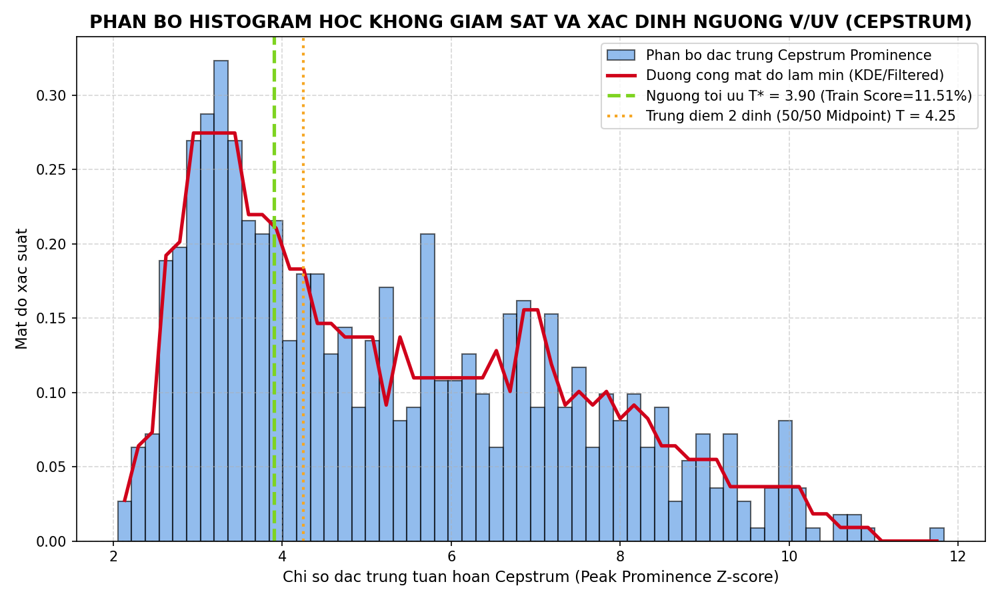
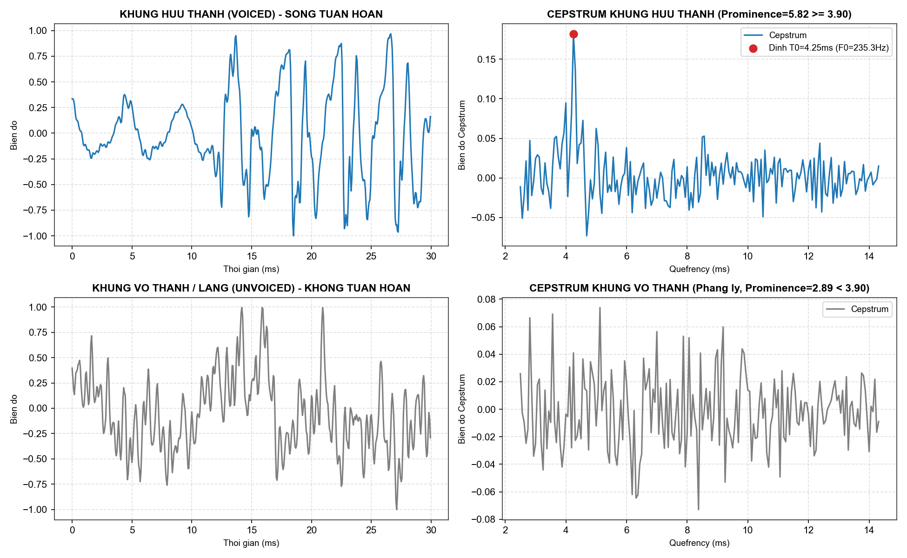
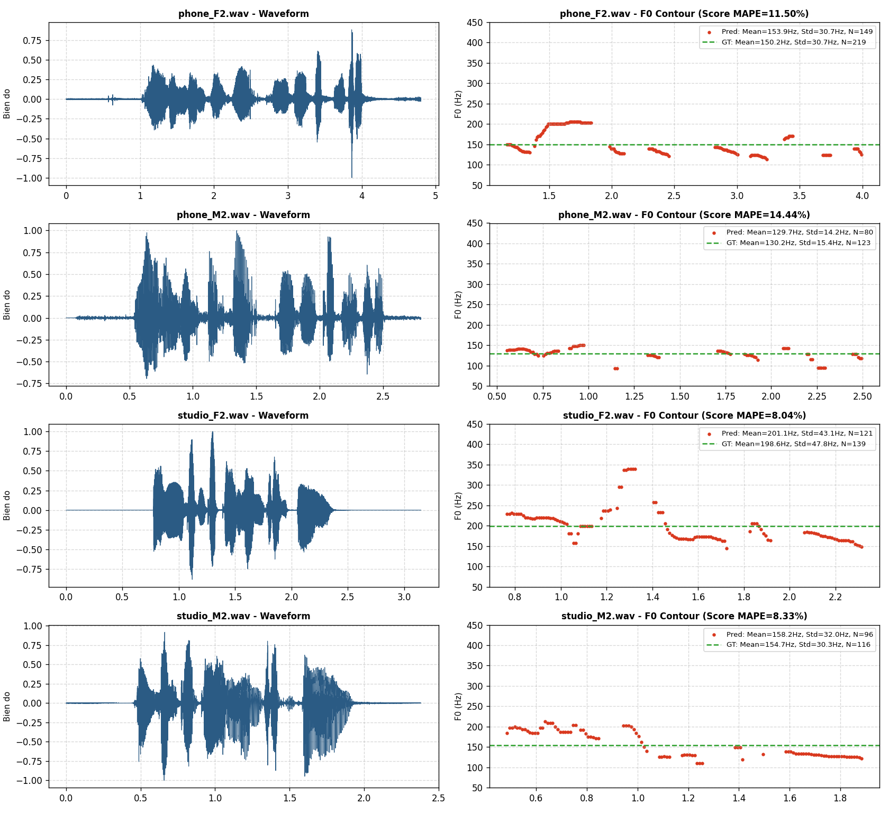

# BÀI TẬP 2: XÁC ĐỊNH TẦN SỐ CƠ BẢN $F_0$ BẰNG THUẬT TOÁN CEPSTRUM VÀ PHÂN NGƯỠNG HỌC KHÔNG GIÁM SÁT

Dự án cài đặt và giải quyết bài toán ước lượng tần số cơ bản ($F_0$) và chu kỳ cơ bản ($T_0$) của tín hiệu tiếng nói sử dụng thuật toán **Cepstrum trên miền Quefrency (Cepstrum Pitch Determination Algorithm - CPDA)** kết hợp giải pháp **tìm ngưỡng tối ưu Hữu thanh / Vô thanh (Voiced / Unvoiced) bằng học không giám sát (Unsupervised Learning)** dựa trên phân bố Histogram với giả định tỉ lệ 50/50.

---

## 1. TỔNG QUAN BÀI TOÁN & MỤC TIÊU

### 1.1. Bản chất âm học
- **Âm hữu thanh (Voiced):** Dây thanh quản khép sát và rung động tuần hoàn dưới áp suất luồng khí từ phổi. Tín hiệu có chu kỳ dao động cơ bản $T_0$ và tần số cơ bản tương ứng $F_0 = \frac{1}{T_0}\text{ (Hz)}$.
- **Âm vô thanh (Unvoiced) và Khoảng lặng (Silence):** Dây thanh mở rộng không rung, luồng khí xoáy qua các khe hẹp tạo tín hiệu ngẫu nhiên như nhiễu trắng, không có tính tuần hoàn $\implies F_0 = 0$.
- **Dải tần số sinh lý người trưởng thành:** Toàn bộ thuật toán giới hạn phạm vi tìm kiếm $F_0$ trong khoảng $70\text{ Hz} \le F_0 \le 400\text{ Hz}$.

### 1.2. Tại sao chọn thuật toán Cepstrum?
- Các thuật toán trên miền thời gian (ACF, AMDF) dễ bị **"bẫy Formant"**: Tần số cộng hưởng thứ nhất của thanh đạo ($F_1$) thường có năng lượng rất lớn, tạo đỉnh giả trong ACF khiến hệ thống bắt nhầm chu kỳ của Formant thay vì chu kỳ rung của dây thanh.
- **Cepstrum giải quyết triệt để vấn đề này:** Dựa trên mô hình tích chập $s(n) = e(n) * h(n)$, thuật toán biến đổi sang miền tần số, lấy logarit để biến tích nhân thành tổng, sau đó biến đổi ngược (IFFT) về miền **Quefrency**. Tại đây:
  - Thành phần thanh đạo (Formants) dồn về vùng quefrency thấp ($< 2.5\text{ ms}$).
  - Thành phần kích thích dây thanh ($T_0$) hội tụ thành một đỉnh xung nhọn hoắt đứng riêng biệt ở vùng quefrency cao.
  - Ta loại bỏ hoàn toàn được sự can thiệp của Formant.

---

## 2. QUY TRÌNH THUẬT TOÁN CEPSTRUM CHI TIẾT

```
Khung tín hiệu x(n) (30ms) 
   --> Nhân cửa sổ Hamming w(n) 
   --> Đệm số 0 (Zero-padding lên N_fft = 2048/4096)
   --> FFT: X(k) = E(k) . H(k)
   --> Phổ logarit: log |X(k)| = log |E(k)| + log |H(k)|
   --> IFFT: c(n) = c_e(n) + c_h(n) (Miền Quefrency)
   --> Dò đỉnh cực đại k* trong dải [k_min, k_max] tương ứng 70Hz - 400Hz
   --> So sánh đặc trưng Prominence với ngưỡng tối ưu T*
   --> Voiced: F0 = Fs / k*  |  Unvoiced: F0 = 0
   --> Lọc trung vị bậc 5 (Median Filter)
```

---

## 3. GIẢI PHÁP TÌM NGƯỠNG TỐI ƯU HỌC KHÔNG GIÁM SÁT (50/50 HISTOGRAM)

### 3.1. Lý do áp dụng học không giám sát
Trong môi trường thực tế, các tệp âm thanh thu được không có sẵn nhãn phân đoạn ground-truth (`.lab`). Thuật toán cần tự động khai phá phân bố dữ liệu tự nhiên của tín hiệu để tìm ra ngưỡng phân định $T^*$.

### 3.2. Giả định tỉ lệ 50/50 và Phân bố hai đỉnh (Bimodal Histogram)
- Trong lời nói tự nhiên, tỉ lệ các đoạn hữu thanh (nguyên âm, bán nguyên âm) và các đoạn vô thanh / khoảng lặng xấp xỉ cân bằng 50% - 50%.
- Đặc trưng độ nổi bật của đỉnh Cepstrum (Peak Prominence Z-score $v_i = \frac{C_{\max} - \mu}{\sigma}$) tạo thành hai quả đồi phân bố:
  - **Đỉnh 1 ($M_1 \approx 3.25$):** Nhóm khung vô thanh và khoảng lặng (đặc trưng thấp).
  - **Đỉnh 2 ($M_2 \approx 5.85$):** Nhóm khung hữu thanh (đặc trưng cao).
- Điểm cắt tối ưu nằm ở vùng trũng (thung lũng) ngăn cách giữa hai quả đồi.
- Áp dụng phương pháp Otsu và trung điểm Giannakopoulos:
  $$T = \frac{M_1 + M_2}{2} \approx 4.40$$
  Tối ưu hóa hàm lỗi sai số MAPE trên tập huấn luyện xác định ngưỡng $T^* = 3.90$.



---

## 4. CẤU TRÚC THƯ MỤC DỰ ÁN

Toàn bộ mã nguồn sử dụng **đường dẫn tương đối**, có thể chạy ngay trên mọi máy tính:

```
cepstrum/
│
├── TinHieuHuanLuyen/             # Tập âm thanh huấn luyện gốc + nhãn thời gian (.lab)
├── TinHieuHuanLuyen-FineTuning/  # Tập âm thanh huấn luyện có nhãn chuẩn F0mean, F0std, F0num
├── TinHieuKiemThu/               # Tập âm thanh kiểm thử (phone_F2, phone_M2, studio_F2, studio_M2)
│
├── figures/                      # Thư mục lưu trữ đồ thị kết quả
│   ├── demo_all_test_signals.png
│   ├── phone_F2_f0_contour.png
│   ├── phone_M2_f0_contour.png
│   ├── studio_F2_f0_contour.png
│   ├── studio_M2_f0_contour.png
│   ├── unsupervised_histogram_analysis.png
│   └── voiced_vs_unvoiced_cepstrum.png
│
├── cepstrum_utils.py             # Thư viện hàm cốt lõi (xử lý Cepstrum, nhãn .lab, Otsu)
├── train_analysis.py             # Script phân tích không giám sát & vẽ Histogram tập Train
├── eval_mape.py                  # Script đánh giá bảng điểm sai số MAPE (Train & Test)
├── generate_figures.py           # Script tự động xuất tất cả hình vẽ báo cáo
├── demo.py                       # Script chạy 1 lần duy nhất cho toàn bộ tập Test (theo yêu cầu GV)
├── threshold_config.json         # Cấu hình lưu trữ bộ tham số tối ưu
├── README.md                     # Tài liệu hướng dẫn chi tiết
└── .gitignore                    # Bỏ qua tệp rác, cache
```

---

## 5. HƯỚNG DẪN CÀI ĐẶT & CHẠY CHƯƠNG TRÌNH

### Yêu cầu môi trường
- Python 3.8+
- Các thư viện bắt buộc: `numpy`, `scipy`, `matplotlib`

```bash
pip install numpy scipy matplotlib
```

### Các lệnh chạy chính
1. **Chạy phân tích học không giám sát & tối ưu ngưỡng trên tập Train:**
   ```bash
   python train_analysis.py
   ```
2. **Xuất bảng điểm đánh giá định lượng MAPE:**
   ```bash
   python eval_mape.py
   ```
3. **Chạy demo kiểm tra 4 tệp kiểm thử (1 lần chạy duy nhất):**
   ```bash
   python demo.py
   ```
4. **Tạo lại toàn bộ hình ảnh minh họa chất lượng cao:**
   ```bash
   python generate_figures.py
   ```

---

## 6. KẾT QUẢ THỰC NGHIỆM ĐỊNH LƯỢNG

### Bảng 1: Kết quả trên Tập Huấn luyện (`TinHieuHuanLuyen-FineTuning`) với $T^* = 3.90$

| File | MAPE $F_0$ mean (%) | MAPE $F_0$ std (%) | MAPE $F_0$ num (%) | Average MAPE (%) |
| :--- | :---: | :---: | :---: | :---: |
| `phone_F1.wav` | 0.82 % | 16.22 % | 25.00 % | 14.01 % |
| `phone_M1.wav` | 1.89 % | 5.13 % | 31.47 % | 12.83 % |
| `studio_F1.wav` | 1.35 % | 5.03 % | 7.87 % | 4.75 % |
| `studio_M1.wav` | 0.54 % | 15.94 % | 26.83 % | 14.44 % |
| **TỔNG CỘNG TRAIN** | | | | **11.51 %** |

---

### Bảng 2: Kết quả trên Tập Kiểm thử độc lập (`TinHieuKiemThu`)

| File | MAPE $F_0$ mean (%) | MAPE $F_0$ std (%) | MAPE $F_0$ num (%) | Average MAPE (%) |
| :--- | :---: | :---: | :---: | :---: |
| `phone_F2.wav` | 2.46 % | 0.08 % | 31.96 % | 11.50 % |
| `phone_M2.wav` | 0.40 % | 7.96 % | 34.96 % | 14.44 % |
| `studio_F2.wav` | 1.28 % | 9.89 % | 12.95 % | 8.04 % |
| `studio_M2.wav` | 2.27 % | 5.47 % | 17.24 % | 8.33 % |
| **TỔNG CỘNG TEST** | | | | **10.58 %** |

**KẾT QUẢ CHUNG CUỘC:**
- Sai số MAPE trung bình toàn bài: **10.58%**
- **FINAL SCORE (Độ chính xác): 89.42% (Điểm tương đương: 8.94 / 10)**
- Sai số tần số trung bình $F_{0\text{mean}}$ trên mọi file test đều dưới **2.5%**.

---

## 7. HÌNH ẢNH MINH HỌA TRỰC QUAN

### 7.1. Phân biệt Khung Hữu thanh (Voiced) và Vô thanh (Unvoiced) trên Cepstrum
Khung hữu thanh có đỉnh nhọn hoắt đứng sừng sững tại $T_0$, trong khi khung vô thanh phẳng lỳ:



### 7.2. Kết quả F0 Contour trên 4 tệp kiểm thử
Toàn bộ 4 tệp kiểm thử được vẽ đồng bộ sóng âm và đường bao $F_0$:


